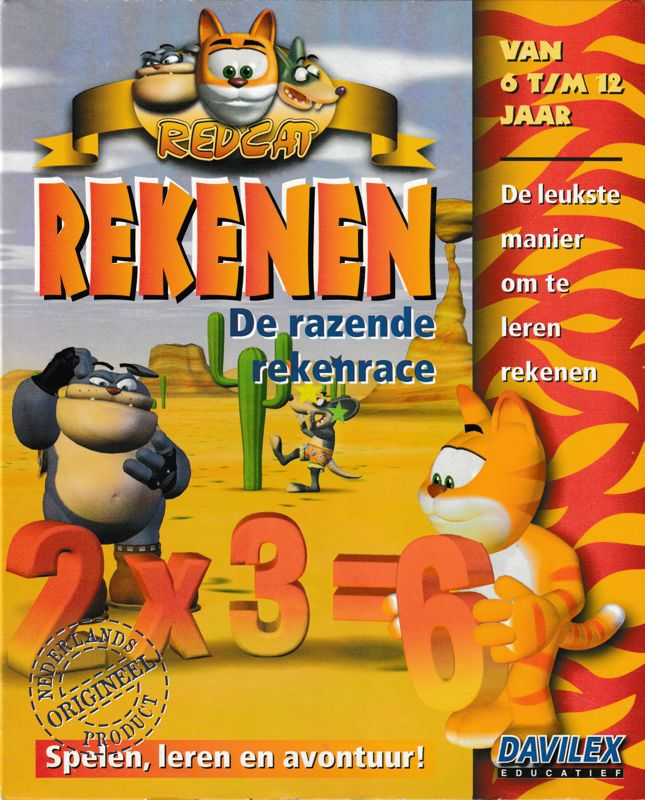
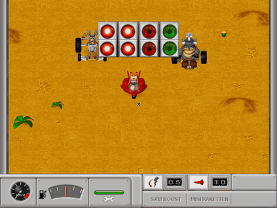
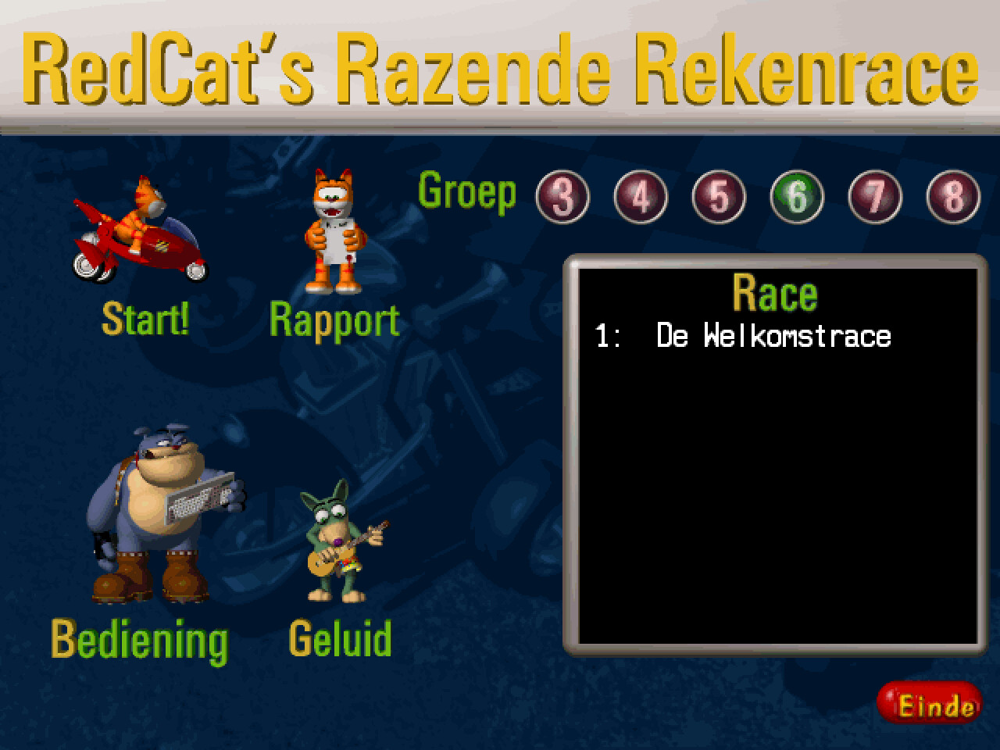
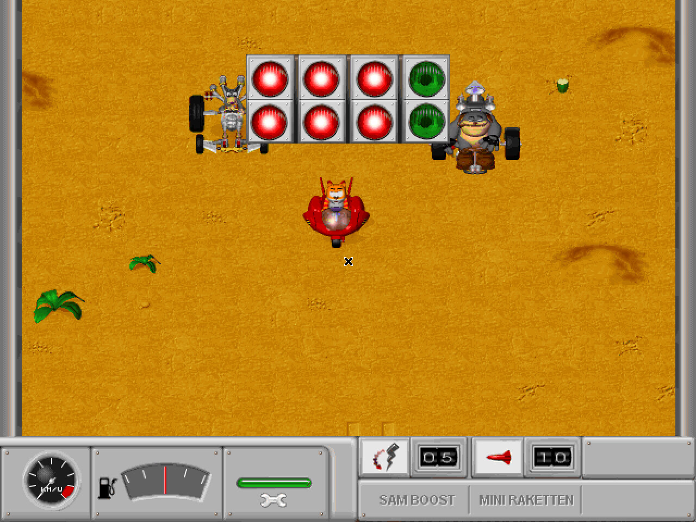
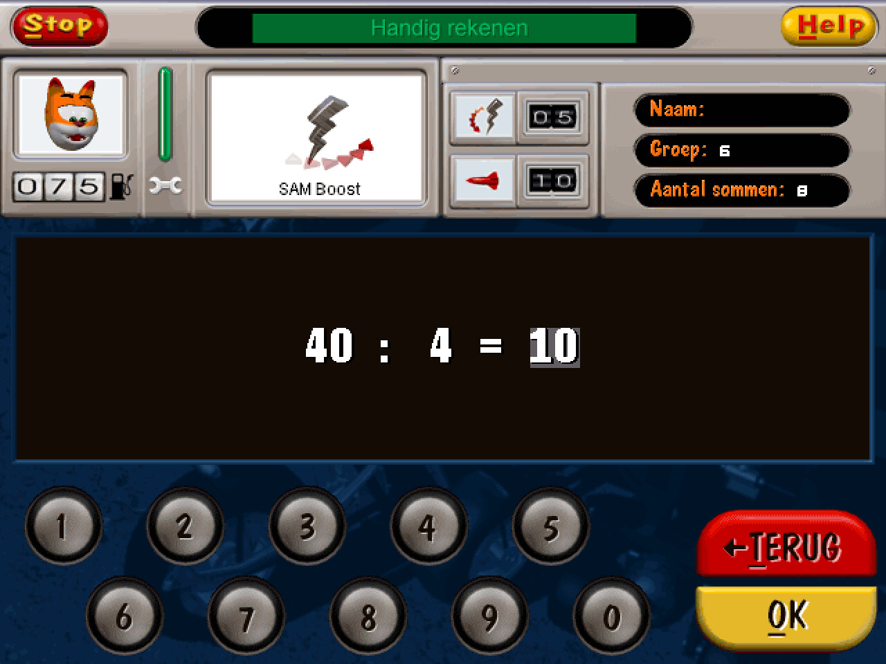

# RedCat's Razende Rekenrace: reverse engineering and port



A study of the 1996 DOS game **RedCat's Razende Rekenrace** (Davilex), a
racing game for primary-school arithmetic, and a reimplementation in C that
plays it on Linux and in the browser.



The research half is notes on how the original works, worked out from its
executables (Watcom C, DOS/4GW) and its data, and from experiments with it
running under DOSBox-X. Each finding records the code addresses it rests on
and how sure it is.

The port is a new engine in C (SDL2) that reads the original game data
unchanged. It plays the game's round as the original does: the intro film,
the menu, the races, the four kinds of arithmetic exercises in between, the
podium and the high scores. The same sources build for the web with
Emscripten.

<p>
  
  
  
</p>

All of these are the port, captured in the first world, De Welkomstrace.

**The game itself is not included.** You need your own copy of the CD.
Nothing here changes or redistributes the original files.

## Playing

You need CMake, a C compiler and SDL2. Point the launcher at the game's data:
the CD root, or the installed `C:\DAVILEX\RCREKEN` (the directory with
`RCS.IND`, `RC.IND` and `TRANS.DAT`):

```sh
port/play.sh <game data dir>                 # the whole game, intro first
port/play.sh <game data dir> --no-intro      # straight to the menu
port/play.sh <game data dir> --race          # straight into a race
```

It builds the port the first time. The game directory is only read: the
record (`RRRIO.INF`), the pupils' results and the high scores go to
`~/.local/share/Davilex/RedCat`, or to the directory given with `--save`.
The other options are in [`port/README.md`](port/README.md).

### In the browser

```sh
port/web/build.sh <game data dir>    # needs Emscripten (emcc)
port/web/serve.sh                    # then open http://localhost:8080/redcat.html
```

The build packs the game data the page needs into `port/web/out/`. Those
files are the original's: keep them to yourself.

## Layout

| Path | Contents |
|---|---|
| `research/discoveries.md` | What has been established, with evidence |
| `research/hypotheses.md` | Ideas that are not settled yet |
| `research/open-questions.md` | Open and resolved questions |
| `reverse-engineering/` | Reference docs: executables, file formats, architecture, running the original under DOSBox-X |
| `reverse-engineering/tools/` | LE loader, disassembler, function finder, xrefs, Unicorn emulation and the DOSBox-X driver |
| `reverse-engineering/analysis/` | Function lists, names, CD inventory |
| `port/` | The C port; [`port/README.md`](port/README.md) is its detailed manual |
| `port/web/` | The WebAssembly build |
| `port/rctools/` | Python tools for the game's archives, images and maps |

## How the research works

Each finding carries a label: CONFIRMED, STRONGLY SUPPORTED, LIKELY or
SPECULATIVE. The notes never present an inference as fact. Evidence from the
binaries and from runtime experiments comes before outside documentation.
Where the port's behaviour comes from the original, its source comments name
the address it was taken from, for example `0x1103e` for the start lights.
Where the port deliberately differs, `port/README.md` says so. The working
rules, and how to set up `.work/`, are in [`AGENTS.md`](AGENTS.md).

The 32-bit programs are LE executables, which most tools do not open.
`reverse-engineering/tools/leparse.py` applies their fixups and writes each
as an ELF image at its run-time addresses. The original runs in a patched
DOSBox-X that `reverse-engineering/tools/dosrun.py` drives on a hidden
display: keys, screenshots, memory and save states; see
[`reverse-engineering/runtime-dosbox.md`](reverse-engineering/runtime-dosbox.md).
The tools need Python 3 with `capstone`, and some `unicorn`.

## Status

The game's round is playable from the intro to the high scores. Not ported
yet: the winner's film after a world's last race (the podium stands in), the
closing film, the menu's joystick set-up and the mouse pointer in the
exercises. The unanswered questions are in `research/open-questions.md`.

## License

This software is released under the [BOLA License](LICENSE). It covers this
project's own code and notes, not the game.

## Legal

RedCat's Razende Rekenrace, its data and its box art (Davilex Software BV,
1996; the cover image is from MobyGames) are the property of their rights
holders. This project contains no game data and is meant for people who own
the game.
